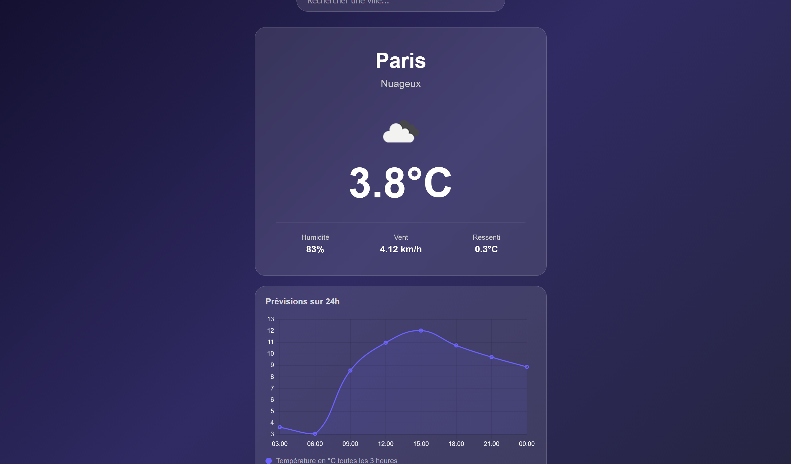
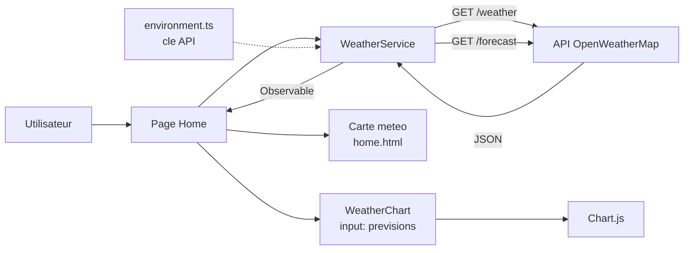
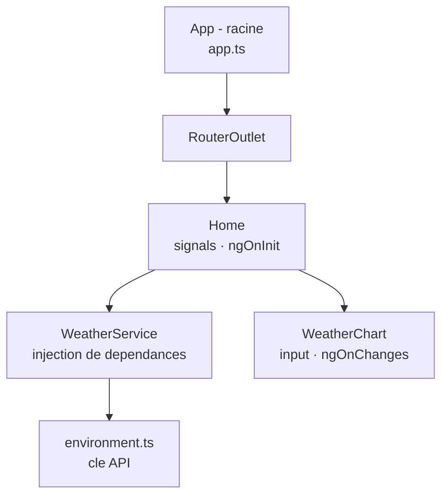

# WeatherDash


Dashboard météo interactif construit avec Angular 21 et l'API OpenWeatherMap. Il affiche la météo actuelle d'une ville et les prévisions de température sur 24h sous forme de graphique — projet personnel réalisé pour pratiquer Angular, TypeScript et la visualisation de données.



---

## Architecture



| Composant | Rôle |
|---|---|
| `Home` | Page principale, orchestre les données et l'état |
| `WeatherService` | Encapsule les deux appels HTTP à l'API |
| `WeatherChart` | Composant dédié au rendu du graphique Chart.js |
| `environment.ts` | Fichier de configuration local, exclu du dépôt |
| API OpenWeatherMap | Source de données météo temps réel |

---

## Stack technique

| Rôle | Outil |
|---|---|
| Framework UI | Angular 21 |
| Langage | TypeScript 5 |
| Requêtes HTTP | HttpClient (Angular) |
| Graphiques | Chart.js 4 |
| Données météo | OpenWeatherMap API |
| Styles | CSS vanilla |

---

## Architecture des composants



---

## Fonctionnalités

- Météo actuelle : température, ressenti, humidité, vitesse du vent en km/h
- Icône météo dynamique selon les conditions et l'heure (variantes jour/nuit)
- Graphique des températures sur les 24 prochaines heures (8 points toutes les 3 h)
- Recherche par ville (touche Entrée), mise à jour immédiate du graphique
- Descriptions en français via `lang=fr`
- Clé API dans `environment.ts`, exclu du dépôt via `.gitignore`

---

## Exemple de résultat

Requête météo actuelle :
```
GET https://api.openweathermap.org/data/2.5/weather?q=Paris&units=metric&lang=fr&appid=<cle>
```

Extrait de la réponse :
```json
{
  "name": "Paris",
  "main": { "temp": 10.2, "humidity": 78, "feels_like": 8.1 },
  "weather": [{ "description": "nuageux", "icon": "04d" }],
  "wind": { "speed": 3.6 }
}
```

Avec `units=metric`, l'API renvoie la vitesse du vent en **m/s**. L'application la convertit en km/h (× 3,6) avant de l'afficher : ici, 3,6 m/s s'affichent 13 km/h.

---

## Choix techniques

- **Angular plutôt que React** : projet délibérément choisi pour pratiquer un framework plus structuré, utilisé dans les grandes entreprises et ESN. Permet de comparer les deux approches après CinéSearch (React).
- **TypeScript strict** : le mode `strict` est activé dans `tsconfig.json`. Exemple concret : `event.target as HTMLInputElement` force une vérification explicite du type avant d'accéder à `.value`.
- **Services Angular + injection de dépendances** : la logique API est isolée dans `WeatherService`. Les composants reçoivent le service via le constructeur, sans instanciation directe.
- **`environment.ts` exclu du dépôt** : la clé API ne figure jamais dans le code versionné. Le dossier `src/environments/` est listé dans `.gitignore`.
- **Signals Angular** : gestion d'état réactive sans `ChangeDetectionStrategy` manuel. Équivalent de `useState` React, mais natif au framework.
- **`ngOnChanges` pour Chart.js** : le graphique se reconstruit quand les données changent. L'instance précédente est détruite via `chart.destroy()` pour éviter les fuites mémoire.
- **Séparation composant/service** : `WeatherChart` ne connaît pas l'API. Il reçoit les données via `input()` depuis `Home`, ce qui le rend réutilisable indépendamment.

---

## Lancer le projet

**Prérequis**
- Node.js 20.19+ ou 22.12+ (requis par Angular 21)
- Angular CLI : `npm install -g @angular/cli`
- Une clé API OpenWeatherMap gratuite : [openweathermap.org/api](https://openweathermap.org/api)

```bash
# 1. Cloner le dépôt
git clone https://github.com/SKGE93/weather-dash.git
cd weather-dash

# 2. Installer les dépendances
npm install

# 3. Créer le fichier d'environnement
mkdir src/environments        # Linux/Mac
# Windows : md src\environments

# 4. Créer src/environments/environment.ts avec le contenu suivant :
```

```typescript
export const environment = {
  production: false,
  apiKey: 'votre_cle_openweathermap'
};
```

```bash
# 5. Lancer le serveur de développement
ng serve
# → http://localhost:4200
```

---

## Tests et qualité

Les fichiers `.spec.ts` générés par Angular CLI sont présents mais non implémentés.

```bash
# Lancer les tests unitaires
ng test

# Build de production
ng build
```

---

## Structure du dépôt

```
weather-dash/
├── src/
│   ├── app/
│   │   ├── components/
│   │   │   └── weather-chart/     # Composant graphique Chart.js
│   │   │       ├── weather-chart.ts
│   │   │       ├── weather-chart.html
│   │   │       └── weather-chart.css
│   │   ├── pages/
│   │   │   └── home/              # Page principale
│   │   │       ├── home.ts
│   │   │       ├── home.html
│   │   │       └── home.css
│   │   ├── services/
│   │   │   └── weather.ts         # Service HTTP OpenWeatherMap
│   │   ├── app.ts                 # Composant racine
│   │   ├── app.config.ts          # HttpClient + Router déclarés ici
│   │   └── app.routes.ts          # Déclaration des routes
│   ├── environments/              # Exclu du dépôt — à créer manuellement
│   │   └── environment.ts         # Clé API
│   ├── index.html
│   ├── main.ts                    # Point d'entrée Angular
│   └── styles.css                 # Styles globaux
├── screenshots/                   # Captures utilisées dans ce README
├── .gitignore                     # Exclut src/environments/
└── package.json
```

---

## Limites et pistes d'amélioration

- Pas de message d'erreur visible si la ville saisie n'existe pas (l'erreur part seulement dans la console)
- Les réponses de l'API sont typées en `any` : les typer avec des interfaces renforcerait l'intérêt de TypeScript
- Les prévisions sur 5 jours sont récupérées mais seules les 24 premières heures sont affichées
- Pas de tests automatisés
- Pas de déploiement en ligne configuré
- La clé API est dans un fichier TypeScript et non côté serveur : un build de production l'inclut dans le code envoyé au navigateur

---

## Auteur

**Séraphin Eyala** — étudiant en MSc Data Engineering & Cloud Computing à aivancity, titulaire d'un BUT Informatique spécialité développement d'applications.

[LinkedIn](https://www.linkedin.com/in/seraphin-eyala-68557b279/) · [Portfolio](https://skge93.github.io/Portfolio/) · [GitHub](https://github.com/SKGE93)
